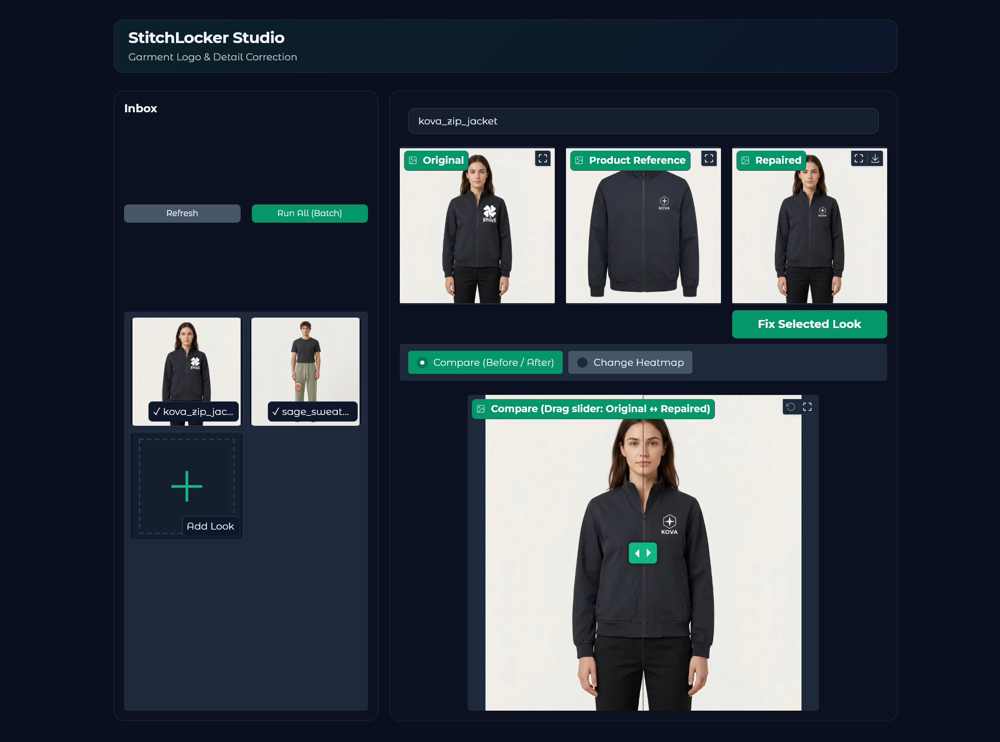
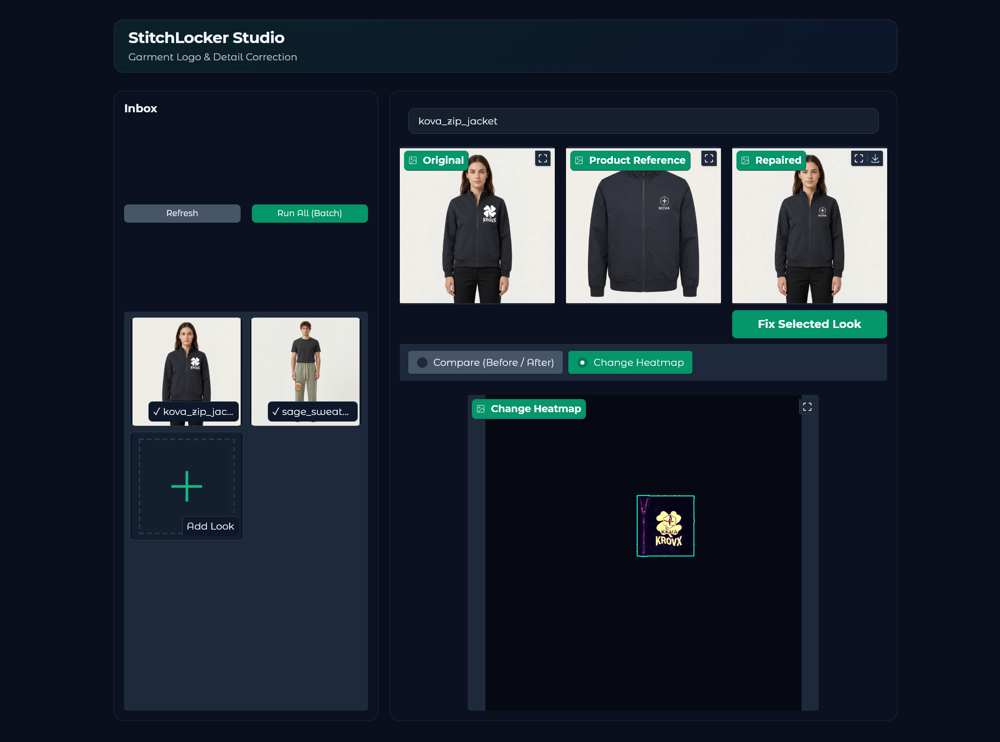
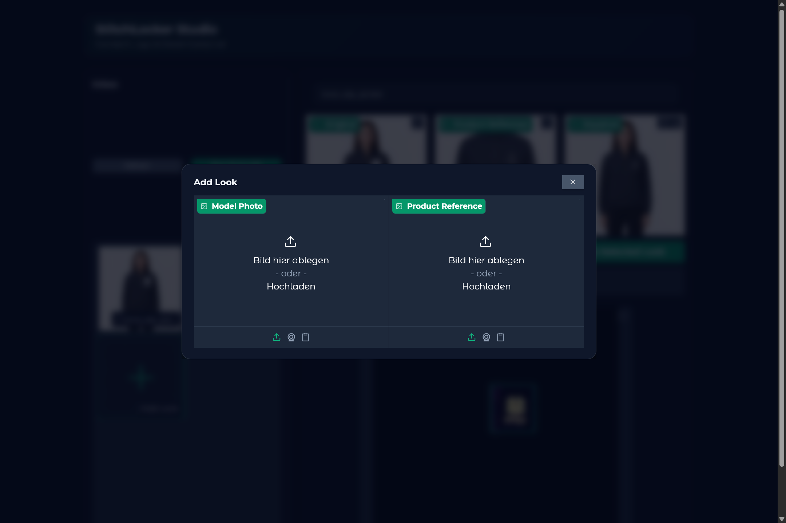
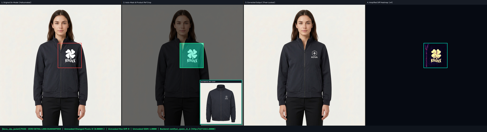
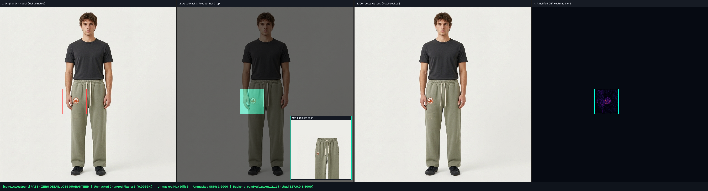
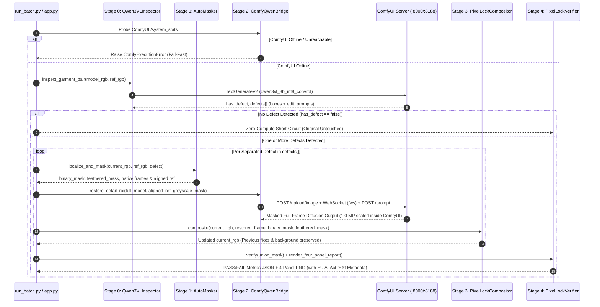

# StitchLocker (`garment-fix-pipeline`)

**Automated E-Commerce Garment Detail Correction Pipeline with Mathematical 0.0% Unmasked Pixel Drift Guarantee**

[](https://www.python.org/)
[](.github/workflows/ci.yml)
[](workflows/qwen_2_1_edit_api.json)
[](docs/ARCHITECTURE.md)
[](src/verifier.py)
[](pyproject.toml)

---

## Executive Summary

When generating On-Model lookbook imagery from e-commerce product packshots, generative models frequently capture the pose, lighting, and garment drape well while hallucinating fine-grained brand details—producing misspelled typography (`"KROVX"` instead of `"KOVA"`), oversized or mutated emblems, or distorted embroidered patches.

Passing the entire image through another diffusion pass degrades skin texture, alters facial identity, and shifts background pixels due to lossy VAE encode/decode cycles.

**StitchLocker (`garment-fix-pipeline`)** solves this with **zero manual intervention**:
1. **Stage 0 — Qwen3-VL-8B Multi-Defect Inspector & Visual Grounding (`src/vlm_inspector.py`)**: Uses ComfyUI's built-in `TextGenerateV2` node on the shared `qwen3vl_8b_int8_convrot.safetensors` checkpoint (0 MB extra VRAM) to verify whether garment logos/text are defective (`has_defect`), localize one or multiple separated defects (`model_bbox_2d` & `ref_bbox_2d`, with overlap deduplication and solo-image contrast re-grounding), and generate direct imperative `edit_prompt`s.
2. **Stage 1 — Full-Frame Masking & Reference Garment Alignment (`src/auto_masker.py`)**: Builds a resolution-relative, interior-feathered full-image mask around each localized defect while preserving the native On-Model resolution/aspect ratio and aligning the full Product Reference garment frame per defect (so `Qwen-Image 2.1` sees all logos and exact garment-to-logo proportions).
3. **Stage 2 — Sequential Multi-Defect Qwen-Image 2.1 Edit (`src/comfy_client.py`)**: Executes a 14-node headless **ComfyUI Qwen-Image 2.1 (`ImageScaleToTotalPixels` + `TextEncodeQwenImage21` + `VAEEncode` + `SetLatentNoiseMask`)** workflow sequentially per detected defect on full native-aspect frames and greyscale masks, scaling to ~1.0 MP (`32px`-aligned) inside ComfyUI to replace oversized/hallucinated logos in true 1:1 garment proportion while anchoring unmasked pose and fabric.
4. **Stage 3 & 4 — Strict Pixel-Lock Compositor & Automated Verification Gate (`src/compositor.py` & `src/verifier.py`)**: Composites each repaired region using perimeter VAE color-shift compensation and interior distance-transform feathering, then enforces a hard global NumPy pixel lock outside the union mask (`np.where(union_binary_mask > 0, ...)`), proving **0.0000% pixel change** (`unmasked_max_abs_diff == 0`, `unmasked_ssim == 1.0000`) in a 4-panel visual report.

---

## Interactive Artist Studio UI (`app.py`)

StitchLocker ships with a clean, full-height 2-column **Artist Studio** (`python app.py` or `run_pipeline.bat`) that manages `test_cases/` pairs (`<name>.png` + `<name>_reference.png`), auto-starts ComfyUI in the background, and shuts it down cleanly when the browser closes:

### Before/After Compare Slider & 3-Up Look Inspection


### 1-Click Change Heatmap View (`4×` Balanced Pixel-Diff)


### `+ Add Look` Upload Pop-Up (Drag & Drop directly into Inbox)


---

## Visual Verification Showcase (Zero-Touch Batch Output on ComfyUI Qwen-Image 2.1)

All showcase cases use **100% synthetic, trademark-free studio assets** (front product packshots paired with photorealistic On-Model lookbook photos containing intentional logo/patch hallucinations), restored and verified with **zero manual brush work**:

### Case 1: Minimalist Full-Zip Track Jacket — Left-Chest Hexagon Compass Crest & `'KOVA'` Embroidery


### Case 2: Sage-Olive Fleece Sweatpants — Right-Thigh Terracotta Twin-Mountain Oval Patch


| Case ID | Garment Detail | Localization Strategy | Backend | Unmasked Pixels Verified | `unmasked_max_abs_diff` | `unmasked_changed_pixels` | `unmasked_ssim` | Status |
| :--- | :--- | :--- | :--- | :---: | :---: | :---: | :---: | :---: |
| `kova_zip_jacket` | White hexagonal compass crest and `KOVA` chest embroidery | `qwen3_vl_8b + vlm_grounded_box` | `comfyui_qwen_2_1` | `1,006,576 / 1,048,576` | **`0`** | **`0 (0.0000%)`** | **`1.0000`** | **PASS** |
| `sage_sweatpant` | Small rust-terracotta and cream oval twin-mountain crest | `qwen3_vl_8b + vlm_grounded_box` | `comfyui_qwen_2_1` | `1,028,136 / 1,048,576` | **`0`** | **`0 (0.0000%)`** | **`1.0000`** | **PASS** |

---

## 1. What I Built (Architecture & 5-Stage Pipeline)

> [!NOTE]
> For mathematical derivations of the Interior Distance-Transform Feathering, Rectified Flow Matching ODE dynamics, and Zero-Recompression PNG Provenance chunks, see [docs/ARCHITECTURE.md](docs/ARCHITECTURE.md).



### Repository Structure
```text
StitchLocker/
├── .github/workflows/ci.yml            # Multi-OS (Ubuntu & Windows) GitHub Actions Quality Gate
├── config.yaml                         # Centralized pipeline, masking, ComfyUI & verification config
├── pyproject.toml                      # Project metadata, dependencies, Ruff, Pyright & Pytest config
├── requirements.txt                    # Runtime, Studio UI & CI dependencies
├── install.bat                         # Windows 1-Click venv installer & CI self-test runner
├── install.sh                          # Linux/macOS 1-Click venv installer & CI self-test runner
├── run_pipeline.bat                    # Windows 1-Click Artist Studio UI launcher (auto ComfyUI lifecycle)
├── run_pipeline.sh                     # Linux/macOS 1-Click Artist Studio UI launcher (auto ComfyUI lifecycle)
├── setup_test_cases.py                 # Ensures flat `<name>.png` + `<name>_reference.png` fixtures exist
├── run_batch.py                        # Zero-touch CLI batch runner (fails fast if ComfyUI offline)
├── app.py                              # Gradio 6.x 2-Column Artist Studio UI with `+ Add Look` pop-up
├── docs/
│   ├── ARCHITECTURE.md                 # Deep mathematical & systems architecture reference
│   └── assets/                         # Artist Studio UI screenshots for documentation
├── workflows/
│   ├── qwen3_vl_inspector_api.json     # ComfyUI API graph for Qwen3-VL-8B defect detection
│   └── qwen_2_1_edit_api.json          # 14-node ComfyUI graph (ImageScaleToTotalPixels + TextEncodeQwenImage21 + SetLatentNoiseMask)
├── scripts/
│   └── run_ci_locally.py               # Local CI Quality Gate runner (Ruff + Formatter + Pyright + Pytest)
├── src/
│   ├── models.py                       # Immutable domain dataclasses, config loader & path safety guards
│   ├── vlm_inspector.py                # Stage 0: Qwen3-VL-8B defect detection & visual grounding
│   ├── auto_masker.py                  # Stage 1: Full-frame mask & reference alignment engine
│   ├── comfy_client.py                 # Stage 2: Pure headless ComfyUI WebSocket/HTTP client (fail-fast)
│   ├── comfy_launcher.py               # Automatic ComfyUI Desktop/standalone startup & cleanup
│   ├── compositor.py                   # Stage 3: Lanczos stitching & strict NumPy pixel-lock compositor
│   ├── verifier.py                     # Stage 4: Mathematical zero-loss verification gate & 4-panel renderer
│   ├── metadata.py                     # Zero-recompression PNG chunk processor (EU AI Act Art. 50 + Audit tags)
│   ├── housekeeper.py                  # Safe local ComfyUI intermediate asset cleanup with NTFS lock retries
│   ├── ui_style.css                    # Full-height 2-column & modal overlay Artist Studio styling
│   ├── ci.py                           # Multi-stage local CI verification orchestrator
│   └── pipeline.py                     # End-to-end orchestrator with atomic .part file writes
├── test_cases/
│   ├── kova_zip_jacket.png             # Synthetic Case 1: On-Model photo (defect)
│   ├── kova_zip_jacket_reference.png   # Synthetic Case 1: Authentic front product reference
│   ├── sage_sweatpant.png              # Synthetic Case 2: On-Model photo (defect)
│   └── sage_sweatpant_reference.png    # Synthetic Case 2: Authentic front product reference
├── outputs/
│   ├── <name>.png                      # Repaired final images matching input case filenames (gitignored locally)
│   └── _reports/                       # 4-panel verification PNGs, diff heatmaps & verification JSONs
└── tests/
    └── test_pipeline.py                # Automated unit, boundary & negative verification test suite
```

---

## 2. How Zero-Loss Pixel Preservation is Guaranteed (Bypassing VAE Degradation)

Passing a full-resolution image through a latent diffusion VAE (`VAEEncode` $\rightarrow$ `VAEDecode`) introduces lossy reconstruction noise across **every pixel** in the frame (typically $\Delta \in [2, 18]$ intensity levels per RGB channel), subtly blurring skin pores, eyes, hair strands, and studio grain.

Furthermore, applying a standard outward Gaussian blur to a binary mask bleeds non-zero alpha values *outside* the mask boundary (`binary_mask == 0`), contaminating surrounding pixels during alpha compositing.

We eliminate both failure modes through two mathematical invariants:

1. **Strictly Interior Distance-Transform Feathering (`src/auto_masker.py`)**:
   Instead of blurring outward across the mask boundary, we compute the Euclidean distance transform `cv2.distanceTransform(binary_mask, cv2.DIST_L2, 5)` **strictly inside** `binary_mask > 0` and apply a cubic Hermite smoothstep ramp:
   $$\alpha(y, x) = \begin{cases} 3t^2 - 2t^3, \quad t = \min\!\left(1, \frac{\text{dist}(y, x)}{w_{\text{ramp}}}\right) & \text{if } M_{\text{bin}}(y, x) = 1 \\ 0 & \text{if } M_{\text{bin}}(y, x) = 0 \end{cases}$$
   This creates a seamless transition inside the dilated mask border while reaching exact $0.0$ at the boundary.

2. **Hard NumPy Pixel Lock (`src/compositor.py`)**:
   After blending inside the ROI, the compositor enforces a bitwise-exact selection guard:
   ```python
   final_image = np.where(binary_mask[..., None] > 0, blended_image, original_image)
   ```
   Every pixel where `binary_mask == 0` is copied directly from the untouched `original_image` buffer in memory, guaranteeing `unmasked_max_abs_diff = 0` and `0.0000%` pixel alteration outside the corrected zone.

---

## 3. What Didn't Work & Key Technical Findings

1. **Tight Logo Cropping Loses Relative Garment Scale**:
   - Cropping out just the defective region and conditioning on a tight crop of the reference emblem removes global garment proportions (leg width, chest span, opposite emblem), causing **Qwen-Image 2.1** to over-scale replacement logos.
   - **Solution**: Conditioning on the full On-Model image (`<image1>`) and full Product Reference garment (`<image2>`, frame-aligned to match torso/leg coordinates when packshot headroom differs) while constraining denoising to the `Qwen3-VL` mask (`VAEEncode` + `SetLatentNoiseMask`) preserves authentic 1:1 logo proportions and keeps the model's pose intact.
2. **Heuristic OpenCV Fallbacks Create "Patchwork / Sticker" Artifacts**:
   - Attempting offline logo replacement via OpenCV stroke erasing and LAB-thresholded texture pasting strips local sheen and creates visible blurred rectangular patches when ComfyUI is offline.
   - **Solution**: All OpenCV and cached ROI fallbacks were removed completely. If ComfyUI is unreachable, the pipeline fails fast with an explicit `ComfyExecutionError` rather than degrading visual quality.
3. **High CFG Cross-Attention Bleeding ("Pink Elephant" Effect)**:
   - Raising `CFG > 1.5` or adding verbose negative prompts in Qwen-Image 2.1 causes global layout contamination from `<image2>` into `<image1>`. Keeping `CFG = 1.0` (`euler` / `simple`, `steps = 20`, `denoise = 1.0`) with `SetLatentNoiseMask` yields natural fold integration while `PixelLockCompositor` restores exact outer pixels.
4. **Dual-Image VLM Coordinate Echoing on Differently Framed Packshots**:
   - When comparing `<image1>` and `<image2>` in one pass, VLMs occasionally echo Image 1 coordinates onto plain cloth in Image 2 when vertical headroom differs, and viewer/wearer `"left/right chest"` phrasing misleads directional edits.
   - **Solution**: `Qwen3VLInspector` detects low-contrast reference boxes automatically and runs a solo-image lookup on `<image2>`, applies universal padding without color-specific hacks, deduplicates overlapping detections, and enforces direct `"Replace..."` prompts without ambiguous left/right labels.

---

## 4. What I Would Try Next in Production

1. **Pose-Aware Garment & Logo Perspective Alignment**:
   - Currently, `_align_full_garment_reference` aligns the reference garment frame to the On-Model frame via 2D translation when framing headroom differs. When a model turns sharply sideways or wears a garment at an extreme perspective angle, a rigid translation cannot match foreshortening.
   - **Next Step**: Use lightweight pose/garment keypoint estimation (e.g. shoulder/chest/hem anchors or DensePose UV) to scale and gently perspective-align the full reference garment frame before passing `<image2>` into `Qwen-Image 2.1`, keeping 1:1 logo proportions across angled poses.
2. **Parallelized Multi-GPU / Cloud Batch Inference**:
   - On a local NVIDIA RTX 4060 Ti (16GB VRAM), sequential 20-step `Qwen3-VL-8B` + `Qwen-Image 2.1` inference takes ~45 seconds per `1024×1024` full-frame case.
   - **Next Step**: Add an async worker pool or cloud inference adapter in `src/comfy_client.py` to process catalog batches in parallel while keeping Stage 1 (Auto-Masker), Stage 3 (Strict Pixel-Lock Compositor), and Stage 4 (Automated Verification Gate) locally enforced as an immutable quality firewall.

---

## 5. Quickstart & Reproducible Verification

### Option A: 1-Click Artist Studio Launcher (Windows & Linux/macOS)
- **Windows**: Double-click **`install.bat`** once to set up the environment, then launch **`run_pipeline.bat`** to start ComfyUI automatically, open the interactive Web UI (`http://127.0.0.1:7860`) in your browser, manage the `test_cases/` inbox (single-case processing or full batch), and cleanly shut down ComfyUI when the browser tab closes.
- **Linux / macOS**: Run `./install.sh` once, then `./run_pipeline.sh` (set `COMFYUI_DIR=/path/to/ComfyUI` if your local ComfyUI install is in a custom path).

### Option B: CLI Commands
```bash
# 1. Install dependencies
pip install -r requirements.txt

# 2. Generate synthetic sample test cases (or drop flat `<name>.png` + `<name>_reference.png` pairs into test_cases/)
python setup_test_cases.py

# 3. Execute zero-touch batch pipeline (requires live ComfyUI on :8000/:8188; fails fast if offline)
python run_batch.py

# 4. Launch interactive Artist Studio UI (auto-opens http://127.0.0.1:7860 in browser)
python app.py

# 5. Run full local CI Quality Gate (Ruff linter + formatter + Pyright + Pytest on Windows/Linux parity)
python scripts/run_ci_locally.py
```
